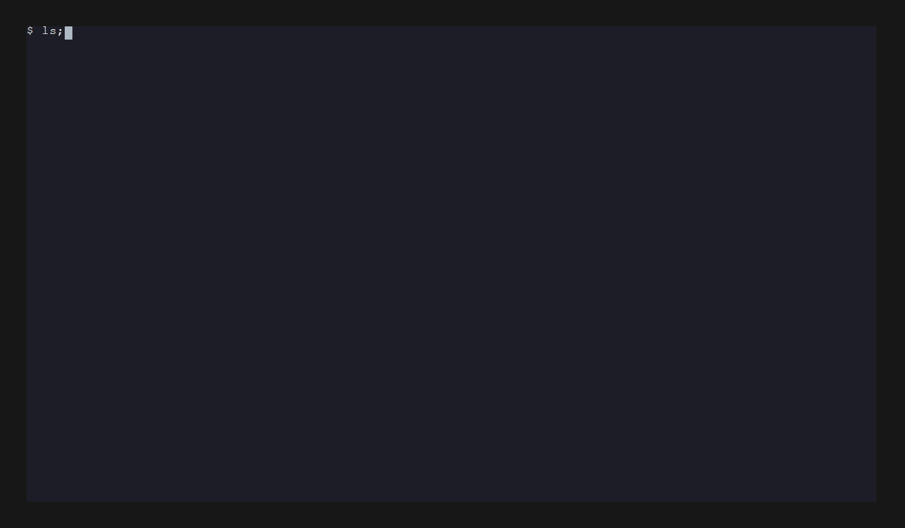

# Using the suite from an AI agent

`cnti-testsuite mcp` serves the suite to an AI agent over the
[Model Context Protocol](https://modelcontextprotocol.io) (MCP). Connected to it, an agent in
Claude Code, Claude Desktop, VS Code or any other MCP client can write your CNF's
`cnti-testsuite.yaml`, install the CNF, run the tests, read the results, change your chart and check
again, all in one conversation.

<p align="center">
  
</p>

The recording is a real Claude Code session against the demo CNF in
[`sample-cnfs/sample-mcp-demo`](../sample-cnfs/sample-mcp-demo), starting from its chart alone, in
six prompts. It plays in real time, with only the idle waits between the prompts cut. The same
session is written out step by step in [A session, start to finish](#a-session-start-to-finish).

This page is the how-to. The protocol itself, with every tool, its annotations and how
cancellation works, is described in [USAGE.md](USAGE.md#mcp-server).

- [Before you start](#before-you-start)
- [Registering the server](#registering-the-server)
- [What it does to your cluster](#what-it-does-to-your-cluster)
- [Writing the configuration](#writing-the-configuration)
- [What you can ask](#what-you-can-ask)
- [A session, start to finish](#a-session-start-to-finish)
- [Long runs](#long-runs)
- [Troubleshooting](#troubleshooting)
- [Recording the demo again](#recording-the-demo-again)

## Before you start

You need:

- a cluster that `KUBECONFIG` points at: a kind cluster on your laptop is enough. Use a test
  cluster, never production: the tests kill containers, drain nodes and inject faults;
- the `cnti-testsuite` binary, from a [release](INSTALL.md) or [built from source](SOURCE_INSTALL.md);
- `cnti-testsuite setup` run once against that cluster;
- your CNF's chart, and its [`cnti-testsuite.yaml`](CNTI_TESTSUITE_YAML_USAGE.md) if you have one.
  If you don't, the agent can write it: see [Writing the configuration](#writing-the-configuration).

**The working directory matters.** The server, and every run it starts, uses the directory it was
started in as its workspace: that is where the `cnti/` directory with the installed CNF and the
results files goes, and where the `cnf_config` paths the agent passes are resolved. Start the server
in your CNF's directory. Each host below says how.

**`KUBECONFIG` has to reach the server.** An MCP host starts the server as a child process, with the
environment the host gives it. Pass `KUBECONFIG` explicitly when your host doesn't inherit your
shell's environment, as the examples below do.

## Registering the server

The server talks over stdio, so it runs on the machine the agent runs on. It has one switch:

| Command | What the agent gets |
|---|---|
| `cnti-testsuite mcp` | The tests and the results: it can run any test against the CNF that's installed, but can't install or remove one. |
| `cnti-testsuite mcp --allow-install` | Also `cnf_install` and `cnf_uninstall`: the agent can install your CNF, and reinstall it after changing the chart, to check a fix. |

Start without `--allow-install` when you install the CNF yourself and want the agent to test and
explain. Add it when you want the agent to work on the chart: changing values and checking the
result needs a reinstall.

### Claude Code

Run this in your CNF's directory. Claude Code starts the server there:

```sh
claude mcp add cnti -e KUBECONFIG="$KUBECONFIG" -- cnti-testsuite mcp --allow-install
claude mcp list        # cnti: cnti-testsuite mcp --allow-install - ✔ Connected
```

`claude mcp add` keeps the server for you in this directory only (`--scope local`, the default).
With `--scope project` it writes `.mcp.json` into the directory instead, to commit for everyone who
works on the chart; Claude Code asks each of them to approve it once.

### Claude Desktop

Claude Desktop starts servers in a directory of its own, so the entry changes into your CNF's
directory first. In `claude_desktop_config.json` (Settings, Developer, Edit Config):

```json
{
  "mcpServers": {
    "cnti": {
      "command": "/bin/sh",
      "args": ["-c", "cd /home/you/my-cnf && exec cnti-testsuite mcp --allow-install"],
      "env": { "KUBECONFIG": "/home/you/.kube/config" }
    }
  }
}
```

Use absolute paths: Claude Desktop doesn't read your shell's `PATH` or environment. Restart Claude
Desktop after saving.

### VS Code

In `.vscode/mcp.json` in your CNF's repository, for agent mode in Copilot Chat:

```json
{
  "servers": {
    "cnti": {
      "type": "stdio",
      "command": "/bin/sh",
      "args": ["-c", "cd \"${workspaceFolder}\" && exec cnti-testsuite mcp --allow-install"],
      "env": { "KUBECONFIG": "${env:HOME}/.kube/config" }
    }
  }
}
```

### opencode

In `opencode.json` (or `opencode.jsonc`) at the root of your CNF's repository, or in your user config:

```json
{
  "$schema": "https://opencode.ai/config.json",
  "mcp": {
    "cnti": {
      "type": "local",
      "command": ["/path/to/cnti-testsuite", "mcp", "--allow-install"],
      "cwd": ".",
      "environment": { "KUBECONFIG": "/home/you/.kube/config" }
    }
  }
}
```

Replace `/path/to/cnti-testsuite` with the binary's absolute path, or with `cnti-testsuite` if
it's on your `PATH`. `cwd: "."` starts the server in your CNF's directory, as the suite
expects. In the global config (`~/.config/opencode/opencode.json`), which applies to every
project, set `cwd` to the CNF directory's absolute path instead.

### Other clients

Any MCP client that starts stdio servers works. It needs the command `cnti-testsuite` with the
arguments `mcp` and, optionally, `--allow-install`, started in your CNF's directory, with
`KUBECONFIG` in its environment. The server implements MCP protocol version `2025-06-18`.

## What it does to your cluster

- **Every run acts on the cluster.** Tests kill containers, change images, scale workloads, drain
  nodes, inject faults and install the tools they need. The server says so: none of the tools that
  run tests claims to be read-only, so your host treats them as destructive and asks before each
  call. Only `list_tests`, `get_run`, `get_results`, `explain_test` and `validate_config` only read.
- **Installing or removing a CNF needs `--allow-install`.** Without it, `cnf_install` and
  `cnf_uninstall` aren't offered at all.
- **One run at a time.** A second run while one is going is refused, not queued: the runs share the
  `cnti/` workspace and the cluster.
- **A cancelled run cleans up.** Cancelling stops the suite and the commands it started. The test
  under way is recorded as an error, what it changed in the cluster is undone (a chaos test's fault,
  a cordoned node), and the results say `status: stopped`. Closing
  the agent stops the runs it started in the same way.

Your host's confirmations are the safety net, so read them: each one names the tool and its
arguments, for example `cnf_install` with `{"cnf_config": "cnti-testsuite.yaml"}`. When you trust a
setup, allow the tools once instead. In Claude Code, `.claude/settings.local.json` in the CNF's
directory:

```json
{
  "permissions": {
    "allow": [
      "mcp__cnti__list_tests", "mcp__cnti__get_run", "mcp__cnti__get_results",
      "mcp__cnti__explain_test", "mcp__cnti__validate_config",
      "mcp__cnti__run_test", "mcp__cnti__start_run",
      "mcp__cnti__cnf_install", "mcp__cnti__cnf_uninstall"
    ]
  }
}
```

Allow only the four read-only tools if you want to confirm every run.

## Writing the configuration

`cnf_install` needs a [`cnti-testsuite.yaml`](CNTI_TESTSUITE_YAML_USAGE.md): which charts, chart
directories or manifests make up the CNF, and settings some tests read. An agent can write it, and the
server gives it what it needs to get it right the first time:

- **Two resources**, the reference that matches this binary: the configuration's JSON Schema
  (`cnti-testsuite://docs/cnti-testsuite-config.schema.json`), with every key, its type and what it
  does, and the configuration guide (`cnti-testsuite://docs/CNTI_TESTSUITE_YAML_USAGE.md`). Hosts
  that support resources let the agent read them, or attach them to your prompt.
- **`validate_config`**, which checks the file as the suite would before installing anything. It is
  read-only, needs no cluster and works while a run is going, so the agent can write, check and fix
  in seconds. A broken file comes back with the suite's reason:

  ```json
  {"valid": false, "messages": ["Error during parsing CNF config on ...", "<the parser's reason>", "..."]}
  ```

Ask for it in plain words: "Write a cnti-testsuite.yaml for the Helm chart in chart/ and check it
with the suite." The agent reads the chart, picks the deployment kind, writes the file and validates
it. The settings for the version-change tests, `container_names` with older and newer image tags,
need released tags of your images; ask for them if you want those tests to run, and check the tags
the agent picks.

The same schema works in your editor: with
`# yaml-language-server: $schema=https://github.com/lfn-cnti/testsuite/raw/main/docs/cnti-testsuite-config.schema.json`
as the first line, editors with the YAML language server complete and check the file as you type.

## What you can ask

Ask in plain language; the agent picks the tools. Prompts like these lead to the tools shown:

| You ask | What happens | Tools |
|---|---|---|
| "Write a cnti-testsuite.yaml for the Helm chart in chart/ and check it with the suite." | The agent reads the chart and the schema, writes the file and validates it. | `validate_config`, the resources |
| "Which essential tests are there, and what does each check?" | The agent lists the tests with their categories and types and explains them. | `list_tests` |
| "Check liveness, readiness and the resource limits of the installed CNF, and tell me what to fix." | Each test runs and the agent explains every failure from its impacted resources and remediation. | `run_test` |
| "Run the essential tests and tell me the result when it's done." | A run of `essential` starts and the agent follows it to the end. | `start_run`, `get_run` |
| "Why did `node_drain` fail in the last run?" | The agent reads the test's result, what the test checks, what the cluster showed when it failed and its own lines of the run's debug log, and explains the finding. | `explain_test` |
| "Install the CNF in this directory, run the liveness and readiness tests, fix what fails in chart/values.yaml, reinstall and check again." | The full loop, as in the recording. Needs `--allow-install`. | `cnf_install`, `get_run`, `run_test`, `cnf_uninstall` |
| "Stop the run." | The run in progress ends and cleans up. | `cancel_run` |

What comes back is the [results document](USAGE.md#results-file), the same JSON the CLI writes with
`--output json`, so the agent works from structured findings rather than from screen output. A
failing test, as the agent received it in the recorded session:

```json
{
  "name": "liveness",
  "status": "failed",
  "message": "One or more workload resources have no containers with a liveness probe",
  "type": "essential",
  "points": 0,
  "remediation": [
    "Ensure that your CNF has a [Liveness Probe](https://kubernetes.io/docs/tasks/configure-pod-container/configure-liveness-readiness-startup-probes/) configured."
  ],
  "impacted_resources": [
    {
      "kind": "Deployment",
      "name": "web-web",
      "namespace": "cnti-default",
      "reason": "no liveness probe on any container (web)"
    }
  ]
}
```

The agent sees which resource failed, in which container, why, and how to fix it. That's usually
enough for it to change the right line of your chart.

## A session, start to finish

The recorded session, step by step. The demo directory starts with a Helm chart and nothing else: a
web server whose `values.yaml` ships with `livenessProbe: {}` and `readinessProbe: {}`, so it has no
probes. The server was registered with `--allow-install`, and you lead the agent through six prompts.

**1. "Write a cnti-testsuite.yaml for the Helm chart in chart/ and check it with the suite."** The
agent lists the chart, reads the configuration guide from the server's resource
(`cnti-testsuite://docs/CNTI_TESTSUITE_YAML_USAGE.md`), writes the file, and checks it with
`validate_config {"cnf_config": "cnti-testsuite.yaml"}` → `{"valid": true, "messages": ["Successfully
validated CNF config"]}`. 24 seconds. What it wrote:

```yaml
# yaml-language-server: $schema=https://github.com/lfn-cnti/testsuite/raw/main/docs/cnti-testsuite-config.schema.json
---
config_version: "v2"
deployments:
  helm_dirs:
    - name: web
      helm_directory: chart
```

It also says what the file leaves out: the version-change tests need `container_names` with released
image tags, which it didn't guess.

**2. "Install the CNF and run the liveness and readiness tests."** `cnf_install` → a `runId`, then
`get_run` until `{"status": "passed", "exitCode": 0}`, then `run_test {"name": "liveness"}` and
`run_test {"name": "readiness"}`. Both fail, with `no liveness probe on any container (web)` and the
same for readiness. The agent finds the cause in `values.yaml`, proposes the fix and asks before
changing anything. 35 seconds.

**3. "Fix the failures directly in the Helm chart. Don't reinstall yet."** The agent edits
`chart/values.yaml` and renders the chart with `helm template` to check that both probes reach the
Deployment:

```yaml
livenessProbe:
  httpGet:
    path: /
    port: http
readinessProbe:
  httpGet:
    path: /
    port: http
```

10 seconds.

**4. "Reinstall the CNF and run both tests again."** `cnf_uninstall`, `get_run` until it has passed,
`cnf_install`, `get_run` until it has passed, and both tests again: `"status": "passed"`, 100 points
each. 56 seconds, most of it the two installs.

**5. "Show me the results of both tests."** The agent answers from the results documents it already
has: per test the status, points, message, details, timing and exit code, the suite build and tool
versions, and the first run's failures for comparison. 6 seconds.

**6. "Show me how you changed the chart."** The diff of `values.yaml` and why each part is there. 4
seconds.

From the first prompt to the last answer the agent works for about two and a quarter minutes on a kind
cluster; the rest of the recording is you reading and typing.

## Long runs

`run_test` answers when the test is done. That suits the quick tests, such as the probes, the limits
or the security checks, which take seconds. Many hosts give up on a tool call after a minute or
so, though (the TypeScript MCP SDK after 60 s), and many tests take longer:

- most chaos tests take more than a minute;
- `node_drain` and `increase_decrease_capacity` wait for workloads to come back;
- the essential tests (`essential`, or `cert`) or a whole category can take an hour or more.

For those, ask the agent to start the run and follow it: "Start the essential tests and check on
them every few minutes." It then uses `start_run`, which answers at once with a `runId`, and
`get_run`, which reports the run's state and, at the end, its results document. `cancel_run` stops
the run and cleans up.

`get_run` reports progress while tests run. An install doesn't report progress, so `get_run` says
`progress: 0` until it ends; an agent that waits on it is doing the right thing.

## Troubleshooting

| What you see | What it means |
|---|---|
| `cnf_install is disabled; start the server with mcp --allow-install to install or uninstall a CNF` | The server runs without `--allow-install`. Register it again with the flag, or install the CNF yourself with `cnti-testsuite cnf_install`. |
| `A run is already in progress; only one run may use the cnti/ workspace and cluster at a time` | Wait for the run, or ask the agent to cancel it. Runs are never queued. |
| `No results file yet; run a test first` | No test has run in this workspace yet. Check that the server runs in your CNF's directory. |
| The agent can't find `cnti-testsuite.yaml`, or tests say no CNF is installed | The server was started in a different directory. Use the `cd ... && exec` form from [Registering the server](#registering-the-server). |
| Every run fails before testing, on the cluster connection | `KUBECONFIG` doesn't reach the server. Pass it in the server's `env`, with an absolute path. |
| `get_results` returns an older run | The runs write their results elsewhere: start the server with the same `--results-dir`, or set `CNTI_TESTSUITE_RESULTS_DIR`, for the server and the CLI. |
| A tool call times out on a long test | Ask for `start_run` and `get_run` instead of `run_test`; see [Long runs](#long-runs). |

The server logs to stderr, which most hosts keep in their MCP logs, and `/mcp` in Claude Code shows
whether the server is connected. `CNTI_TESTSUITE_LOG_LEVEL=debug` in the server's environment makes
the server and its runs log in detail.

## Recording the demo again

The demo CNF is [`sample-cnfs/sample-mcp-demo`](../sample-cnfs/sample-mcp-demo), and a spec checks that
it still fails both probe tests as shipped and passes them with the probes above. The recording
comes from [`images/cnti-testsuite-mcp-demo.tape`](images/cnti-testsuite-mcp-demo.tape), a
[VHS](https://github.com/charmbracelet/vhs) script whose comments list what it needs: the demo's
`chart/` alone in a directory with a neutral path, the server registered there, the tools allowed so
the session runs unattended, and Claude Code's demo mode so the recording shows no account. The
script writes the frames; the GIF is made from them with the idle waits between prompts cut. The
session is real, so a new recording differs in its details.
